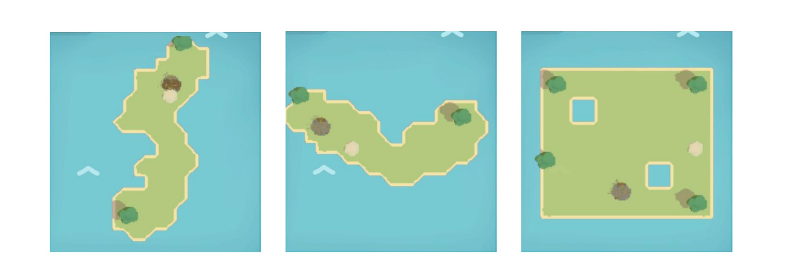
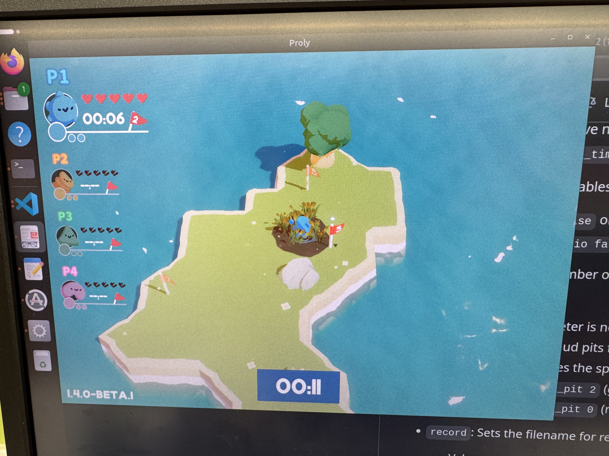
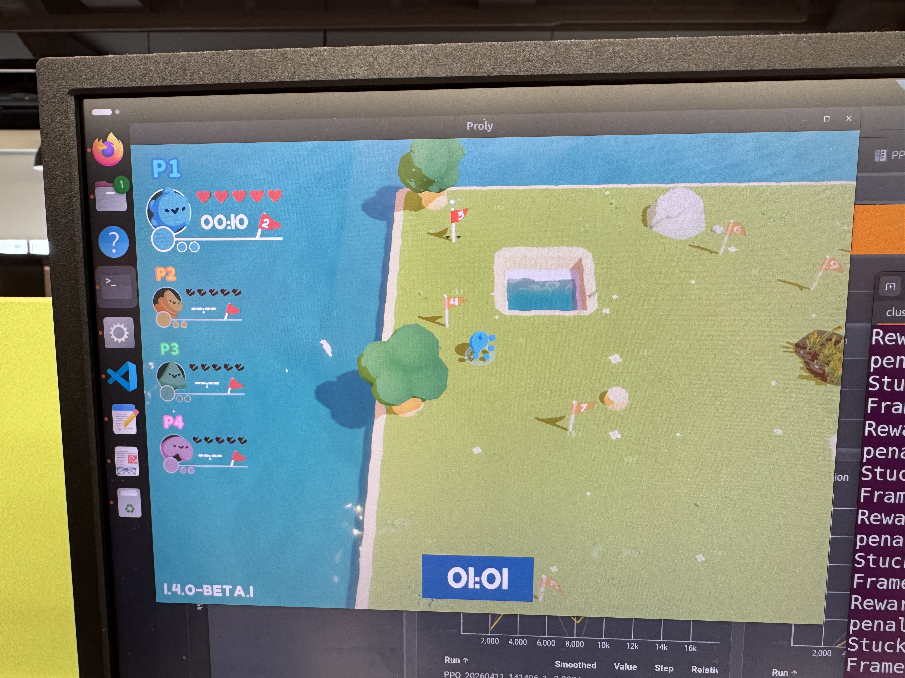

# Robotic Navigation and Exploration – Reinforcement Learning Control

Two deep reinforcement learning projects: (1) implementing PPO (Proximal Policy Optimization) from scratch — Actor-Critic networks, GAE, clipped surrogate objective — to train a path-tracking controller, and (2) designing a reward function for an agent collecting flags in a hazard-filled environment ("Proly"). Built for the "Robotic Navigation and Exploration" course (NTHU).

> The original project description (written by the course instructor) is not included here for copyright reasons. It can be found here: [Project description](https://drive.google.com/file/d/16tJOTcIjzi3UTPFg5TDJh-60vhsdZi10/view?usp=drive_link).

> My own written reports: [Path Tracking PPO report](https://drive.google.com/file/d/18kgK_eiHgwyJ0RHem-CHN5BkvW2DS7Jx/view?usp=drive_link), [Proly reward design report](https://drive.google.com/file/d/1SOsn-4nj8iaJRFMemk1cuwJBF8X4NY8O/view?usp=drive_link).

## Structure

```
path-tracking-ppo/      # PPO implementation for path-tracking
├── train.py             # Main training loop
├── agent.py, model.py    # Policy/value networks, PPO agent
├── env_runner.py, multi_env.py, wrapper.py   # Parallel rollout collection
├── PathTracking/, Simulation/                # Kinematic models + controller
└── save/                 # Trained model checkpoint + training return log


proly-reward-design/    # Reward-function design for flag collection in "Proly"
├── rl_play.py             # MLPlay class that trains the model with PPO (TODO)
├── model_play.py          # MLPlay class that plays Proly with the trained model.zip
├── kb_play.py             # MLPlay class to play Proly with the keyboard, for debugging
├── dummy_env.py           # Dummy class to initialize StableBaselines' PPO policy (do not modify)
├── pu_train.sh, pu_merge.py
├── models/*/*.zip         # Model checkpoints
├── model.zip              # Latest/submitted model checkpoint
└── Proly.app/.exe/.x86_64 # Game executable (depends on OS, not included here)


docs/                   # Figures referenced below
```

## Reward Function Design for Flag Collection

**Task**
- Design a reward function to train an RL agent to play Proly: collect as many flags as possible within 120 seconds, in a world with water and obstacle hazards.
- Graded on 3 maps here — so the reward has to produce a general navigation policy, not one that memorizes a single map.



**What is Proly?** A Unity-based game environment. **MLGame3D** bridges the Unity game and the RL algorithm — each timestep it sends observations to `MLPlay.update()`, which returns an action; when an episode ends, `MLPlay.reset()` runs before the next one starts.

The main design challenge was that a naive reward function left the agent stuck circling in place whenever a flag was only reachable through a narrow path or past open water — the risk of the hazard outweighed the reward for reaching the flag, so the agent reached water, panicked, and looped nearby instead of crossing it.

<table>
<tr><td><br><sub>(a) Flag only reachable via a narrow path</sub></td>
<td><br><sub>(b) Flag positioned behind open water</sub></td></tr>
</table>

To fix this, the reward function combines these signals, by priority:

| # | Signal | Reward | When |
|---|--------|--------|------|
| 1 | Death | −60 | once, on death |
| 2 | Flag capture | +15 | once per flag |
| 3 | Terrain | −2 water / −1 obstacle / up to −2 nearby | every frame |
| 4 | Stuck (frozen/circling) | up to −1.5 | every frame |
| 5 | Distance to flag | ±0.7 | every frame |
| 6 | Heading to flag | ±0.5 | every frame |
| 7 | No progress | −0.3 to −1.0 | after 5s / 10s / 30s idle |
| 8 | Time | −0.01 | every frame |

Entropy coefficient was also raised from 0 to 0.01, so the policy doesn't settle on one action (e.g. walking into the same wall) too early.

**Demo video:** [RL Control Playing Proly — 3 Maps](https://youtu.be/N9PysWJFPTs) — PPO + custom-designed reward function, collecting flags while avoiding water and obstacle hazards.
